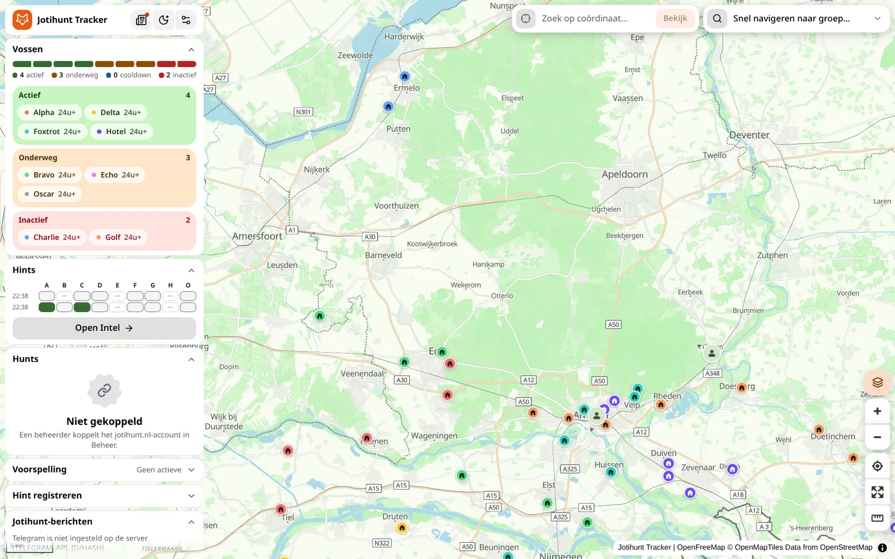
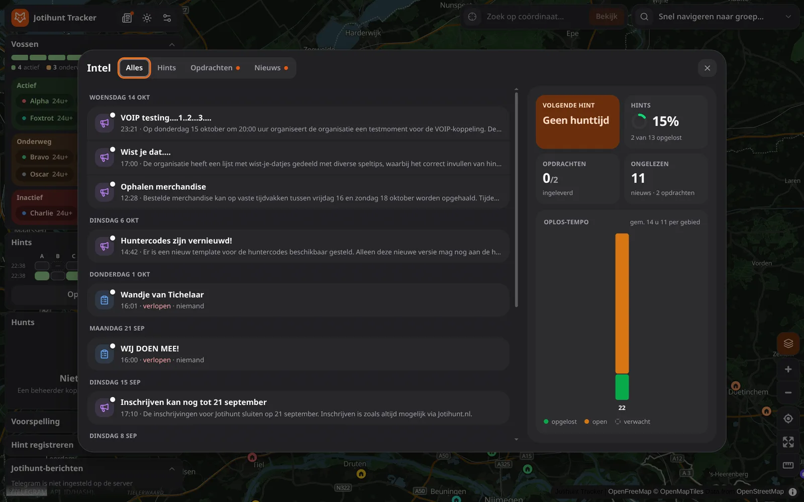
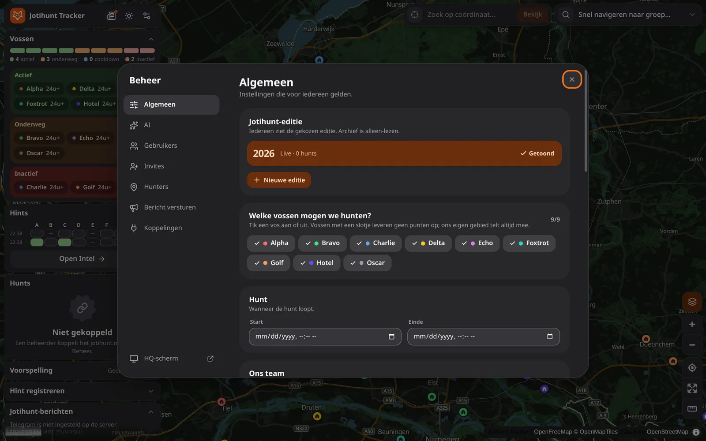
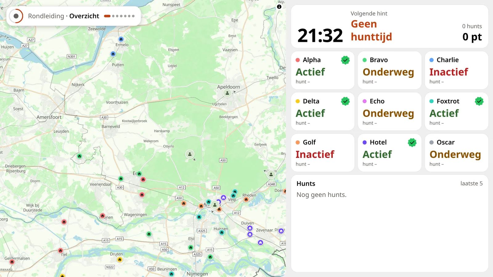
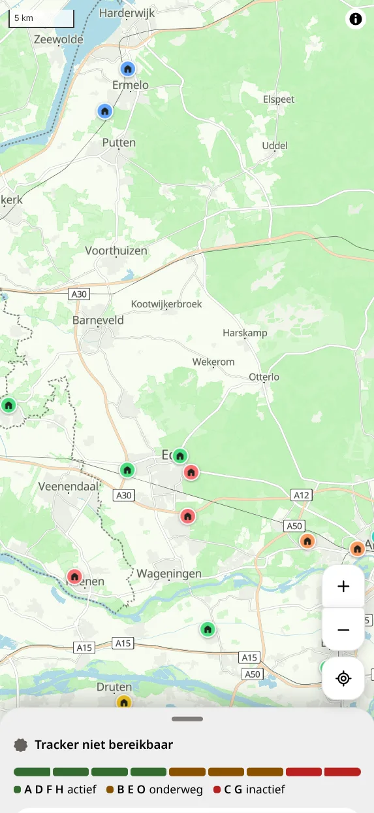

# 🦊 Jotihunt Tracker - Server

Backend van de Jotihunt Tracker: één Express-API (op [Bun](https://bun.sh/), met MongoDB) die de vossen, hints, hunts, hunters en berichten van de [Jotihunt](https://jotihunt.nl) bijhoudt. De server haalt zelf gegevens op bij jotihunt.nl, Traccar, Telegram, Life360 en Jotiboard en levert alles aan de webapp en de Android-app.

> [!NOTE]
> Bedoeld voor gebruik met de [Jotihunt Tracker Client](https://github.com/ScoutingScherpenzeel/jotihunt-tracker-client). Zonder client werkt de API wel, maar er is geen andere frontend.

<p align="center">
  
</p>

## Inhoud

- [Wat de server doet](#wat-de-server-doet)
- [Architectuur](#architectuur)
- [Installatie met Docker Compose](#installatie-met-docker-compose)
- [Omgevingsvariabelen](#omgevingsvariabelen)
- [Eerste keer opstarten](#eerste-keer-opstarten)
- [GPS-tracking](#gps-tracking)
- [Koppelingen](#koppelingen)
- [Lokaal ontwikkelen](#lokaal-ontwikkelen)
- [Scripts](#scripts)
- [API-overzicht](#api-overzicht)
- [Prestaties](#prestaties)
- [Deployment](#deployment)
- [Bijdragen](#bijdragen)
- [Licentie](#licentie)

## Wat de server doet

- **Vossen en gebieden**: deelgebieden en vossenstatus (groen/oranje/rood, plus blauw: Oscar met het OV) uit de Jotihunt-API, met een statusgeschiedenis per vos (`/areas`).
- **Hints en opdrachten**: nieuws, hints en opdrachten uit de Jotihunt-API. Hints worden per deelgebied gesplitst (regels, en met Gemini nagekeken) en hunters kunnen per vak een antwoord invullen (`/hints`). Wat er per opdracht is ingeleverd en beoordeeld, komt van jotihunt.nl.
- **Hunts en punten**: de website-scraper logt in op jotihunt.nl en synchroniseert de hunts van de groep (QR-hunts) en de voorlopige score. Hunts met een locatie worden markers op de kaart.
- **Markers**: hints, hunts en spots die hunters zelf op de kaart zetten, per speelhelft.
- **Hunters**: live posities uit Traccar, plus koppelen van telefoons (Android-app met koppelcode, iPhone via Traccar Client).
- **Kaartlagen**: 3D-gebouwen (3DBAG-vectortegels), fastfood (McDonald's, KFC, Burger King uit OpenStreetMap), routes tussen vossenlocaties over echte paden (GraphHopper, 's nachts zonder gesloten bossen) en het bereik van elke vos.
- **AI (Gemini, optioneel)**: vossenvoorspelling, samenvattingen van nieuws en opdrachten, hint-splitsing en de Intel-chat met eigen tools (app-data, kaart, OV/NS, plaatsen uit OpenStreetMap, luchtfoto's, optioneel zoeken op het web). De AI stelt alleen voor; opslaan doet altijd een mens.
- **Meldingen**: web push en een meldingenfeed (vossenstatus, hints, nieuws, nieuwe hunts, tegenhunt, happy hour, cooldown, berichten van HQ).
- **Inloggen zonder wachtwoord**: passkeys, uitnodigingen, herstel-links, inloggen met QR-code en koppelcodes voor de app.
- **Edities**: elk jaar een eigen database; oude edities blijven als archief (alleen-lezen) te bekijken.
- **Beheer**: instellingen, gebruikers, invites, koppelingen en AI-modellen via de API in plaats van `.env`.

| Intel (nieuws, hints, opdrachten) | Beheer |
| --- | --- |
|  |  |

| HQ-scherm (`/hq`) | Telefoon |
| --- | --- |
|  |  |

## Architectuur

```mermaid
flowchart LR
  client[Webapp / Android-app] -->|REST + SSE| server[Server<br/>Express op Bun]
  server --> mongo[(MongoDB)]
  server --> traccar[Traccar]
  server --> jh[jotihunt.nl<br/>API + website]
  server --> tg[Telegram<br/>@Jotihunt_bot]
  server --> l360[Life360]
  server --> jb[Jotiboard]
  server --> router[GraphHopper-router]
  server --> gemini[Google Gemini]
  server --> push[Web Push]
  server --> sentry[Sentry]
```

| Onderdeel | Rol | Nodig? |
| --- | --- | --- |
| **MongoDB** | Alle gegevens. Een controledatabase (gebruikers, sessies, instellingen, koppelingen, caches) en per editie een database met spelgegevens. | Ja |
| **Traccar** | Ontvangt de GPS-posities van de hunters (poort `5055`) en levert ze via de API. | Voor live tracking |
| **Jotihunt-API** | Deelgebieden, vossenstatus en artikelen, elke 10 seconden. | Ja |
| **Jotihunt-website** | Scraper met het account van de groep: hunts (elke minuut), voorlopige score en ingeleverde opdrachten. | Optioneel |
| **Telegram** | Leest de berichten van @Jotihunt_bot aan het groepsaccount: tegenhunts en happy hours worden meldingen. | Optioneel |
| **Life360** | Posities van teamleden in een Life360-kring, als extra kaartlaag (onofficiële API, alleen in het geheugen). | Optioneel |
| **Jotiboard** | Neemt pins en hint-oplossingen over van [Jotiboard](https://jotiboard.nl) (alleen lezen). | Optioneel |
| **GraphHopper-router** | Eigen container (map [`router/`](router/)): looproutes en autoroutes voor de vossensporen. | Optioneel |
| **Google Gemini** | Vossenvoorspelling, samenvattingen, hint-splitsing, Intel-chat. | Optioneel |
| **Web Push (VAPID)** | Pushmeldingen naar browsers en de geïnstalleerde PWA. | Optioneel |
| **Sentry** | Foutmeldingen van server en website (via `/sentry-tunnel`). | Optioneel |

Ontbreekt een optioneel onderdeel, dan logt de server bij het starten een waarschuwing en staat alleen die functie uit.

## Installatie met Docker Compose

Deze installatie start de server, de client, MongoDB en [Traccar](https://www.traccar.org/). Traccar stel je daarna nog zelf in.

1. Maak een `docker-compose.yml`:

```yaml
services:
  server:
    image: ghcr.io/scoutingscherpenzeel/jotihunt-tracker-server:latest # of ":main" voor de laatste ontwikkelversie
    restart: unless-stopped
    env_file:
      - .env
    ports:
      - "3000:3000"
    volumes:
      - uploads:/usr/src/app/uploads
      - ./app-releases:/usr/src/app/app-releases # optioneel: APK van de Android-app
  client:
    image: ghcr.io/scoutingscherpenzeel/jotihunt-tracker-client:latest
    restart: unless-stopped
    env_file:
      - .env
    ports:
      - "80:80"
  mongodb:
    image: mongo:latest
    restart: unless-stopped
    volumes:
      - mongodb:/data/db
  traccar:
    image: traccar/traccar:ubuntu
    restart: unless-stopped
    ports:
      - 5055:5055 # posities van de telefoons
      - 8082:8082 # webinterface en API
    volumes:
      - traccar_logs:/opt/traccar/logs
      - traccar_data:/opt/traccar/data
      - traccar_conf:/opt/traccar/conf
  # Optioneel: routes over echte paden. Start alleen met `--profile router`; de eerste build downloadt OSM-data van Nederland en duurt een tijd.
  router:
    image: ghcr.io/scoutingscherpenzeel/jotihunt-router:main
    profiles: [router]
    restart: unless-stopped
    volumes:
      - router_data:/data

volumes:
  mongodb:
  traccar_logs:
  traccar_data:
  traccar_conf:
  uploads:
  router_data:
```

2. Maak in dezelfde map een `.env` (zie [Omgevingsvariabelen](#omgevingsvariabelen)). Minimaal:

```env
TZ=Europe/Amsterdam
MONGO_URI=mongodb://mongodb:27017/jotihunt
JWT_SECRET=een-lange-willekeurige-string-van-minimaal-32-tekens
WEBAUTHN_RP_ID=jotihunt.jouwscoutinggroep.nl
WEBAUTHN_ORIGINS=https://jotihunt.jouwscoutinggroep.nl
PUBLIC_APP_URL=https://jotihunt.jouwscoutinggroep.nl
SETTINGS_KEY= # openssl rand -base64 32

JOTIHUNT_API_URL=https://jotihunt.nl/api/2.0
JOTIHUNT_WEB_URL=https://jotihunt.nl

TRACCAR_API_URL=http://traccar:8082
TRACCAR_API_TOKEN=token-van-traccar
TRACCAR_CLIENT_URL=http://tracker.jotihunt.jouwscoutinggroep.nl:5055

# Optioneel, met de router-service hierboven (docker compose --profile router)
ROUTER_URL=http://router:8989
ROUTER_ADMIN_URL=http://router:8990

# Client
API_BASE_URL=https://api.jotihunt.jouwscoutinggroep.nl
TEAMS_AREA_EDITING=false
```

3. Start alles:

```bash
docker compose up -d
```

De router start alleen als je het profiel `router` meegeeft:

```bash
docker compose --profile router up -d
```

| Service | Adres |
| --- | --- |
| `server` | http://localhost:3000 |
| `client` | http://localhost:80 |
| `traccar` | http://localhost:8082 |
| `mongodb` | alleen intern |
| `router` | alleen intern (`8989` routes, `8990` status/rebuild), alleen met `--profile router` |

Passkeys werken alleen op `https://` of op `localhost`. Zet de server en client in productie dus achter een reverse proxy met TLS.

## Omgevingsvariabelen

Alle variabelen staan ook in [`.env.example`](.env.example). Veel instellingen die vroeger in `.env` stonden (team, hunttijden, voertuiggroepen, Gemini, Jotihunt-login, Telegram-app) stel je nu in via **Beheer** in de webapp. De oude variabelen werken nog als terugval zolang Beheer geen waarde heeft.

### Basis (verplicht)

| Variabele | Beschrijving |
| --- | --- |
| `MONGO_URI` | MongoDB-verbinding, bijvoorbeeld `mongodb://mongodb:27017/jotihunt`. De databasenaam is de controledatabase; edities krijgen er een eigen database naast. |
| `JWT_SECRET` | Willekeurige string van minimaal 32 tekens; ondertekent de sessie- en apparaattokens. |
| `WEBAUTHN_RP_ID` | Hostnaam van de website zonder `https://`, pad of poort (lokaal `localhost`). Passkeys horen bij deze naam: verander je hem, dan moet iedereen via een herstel-link een nieuwe passkey maken. |
| `WEBAUTHN_ORIGINS` | Elk adres waarop de website geopend wordt, met komma's gescheiden, bijvoorbeeld `https://jotihunt.jouwscoutinggroep.nl,http://localhost:5173`. |
| `PUBLIC_APP_URL` | Adres van de website, voor uitnodigings- en herstel-links. |

Zonder `JWT_SECRET`, `MONGO_URI`, `WEBAUTHN_RP_ID`, `WEBAUTHN_ORIGINS` of `PUBLIC_APP_URL` start de server niet.

### Server

| Variabele | Standaard | Beschrijving |
| --- | --- | --- |
| `PORT` | `3000` | Poort van de API. |
| `TZ` | | Zet op `Europe/Amsterdam`: stickertijden en deadlines worden in lokale tijd gelezen. |
| `DEBUG` | `false` | Extra logging, inclusief MongoDB-queries. |
| `TRUST_PROXY` | | Achter een reverse proxy bijvoorbeeld `1`, zodat de limieten per IP-adres (inloggen, app koppelen) het echte adres zien. Ook `true`/`false` of een lijst subnetten. |
| `CLIENT_IP_HEADER` | | Header met het echte clientadres, bijvoorbeeld `cf-connecting-ip` achter Cloudflare Tunnel (samen met `TRUST_PROXY=1`). Alleen zetten als alle verzoeken via die proxy binnenkomen. |
| `WEBAUTHN_RP_NAME` | `Jotihunt Tracker` | Naam in de passkey-dialoog van de browser. |
| `SETTINGS_KEY` | | 32 willekeurige bytes in base64 (`openssl rand -base64 32`). Versleutelt de sleutels en wachtwoorden die in Beheer worden opgeslagen. Zonder deze key kun je in Beheer geen geheimen opslaan. |
| `UPLOADS_DIR` | `./uploads` | Opslag van geüploade bestanden (logo van de groep). |
| `APP_DIR` | `./app-releases` | Map met de APK van de Android-app en `latest.json`. |
| `TEAMS_AREA_EDITING` | `false` | `true`: gebruikers mogen deelgebieden van groepen aanpassen (beheerders kunnen het altijd). Handig als de deelgebieden pas tijdens de hunt bekend zijn. |

### Jotihunt

| Variabele | Beschrijving |
| --- | --- |
| `JOTIHUNT_API_URL` | `https://jotihunt.nl/api/2.0`. Zonder deze variabele worden gebieden en artikelen niet opgehaald. |
| `JOTIHUNT_WEB_URL` | `https://jotihunt.nl`. Nodig voor de scraper (hunts, score, opdrachten). |
| `JOTIHUNT_WEB_USERNAME`, `JOTIHUNT_WEB_PASSWORD` | Terugval voor de login van jotihunt.nl. Liever invullen in **Beheer → Algemeen → Jotihunt-site**. |

### Traccar

| Variabele | Beschrijving |
| --- | --- |
| `TRACCAR_API_URL` | Adres van de Traccar-API, bijvoorbeeld `http://traccar:8082`. |
| `TRACCAR_API_TOKEN` | Token van een Traccar-**beheerder** (de server maakt hiermee apparaten aan). In Traccar: `Instellingen` → `Voorkeuren` → `Token`, kies een verloopdatum en ververs. |
| `TRACCAR_CLIENT_URL` | Waar de Traccar Client-app de posities naartoe stuurt: jouw Traccar-server op poort `5055`. Komt in de QR-code in "Mijn tracker". Lokaal testen met een telefoon op hetzelfde wifi: het LAN-adres van je computer, bijvoorbeeld `http://192.168.1.10:5055`. |

Zonder `TRACCAR_API_URL` en `TRACCAR_API_TOKEN` geven de tracker-endpoints `503`.

### Optionele koppelingen

| Variabele | Beschrijving |
| --- | --- |
| `ROUTER_URL` | GraphHopper-router voor routes over echte paden, bijvoorbeeld `http://router:8989`. Zonder: rechte lijnen tussen vossenlocaties en alleen cirkels voor het bereik. |
| `ROUTER_ADMIN_URL` | Status- en rebuild-endpoint van de router, bijvoorbeeld `http://router:8990`. Voor de kaart "Routes" in Beheer. |
| `ORS_API_KEY` | [OpenRouteService](https://openrouteservice.org/)-key voor looptijden in de vossenvoorspelling. Zonder: rechte lijn × 1,3 bij 5 km/u. Er gaan alleen coördinaten heen. |
| `NS_API_KEY` | [NS Reisinformatie API](https://apiportal.ns.nl/) voor treinen in de OV-tools van de Intel-chat. Zonder: alleen bus, tram, metro en boot (OVapi, geen key nodig). |
| `VAPID_PUBLIC_KEY`, `VAPID_PRIVATE_KEY`, `VAPID_SUBJECT` | Web push. Maak eenmalig met `npx web-push generate-vapid-keys`; `VAPID_SUBJECT` is een `mailto:`-adres. Zonder: geen push, wel meldingen in de app. |
| `TELEGRAM_SESSION_KEY` | 32 bytes base64. Versleutelt de Telegram-sessie. Zie [Telegram](#telegram). |
| `TELEGRAM_API_ID`, `TELEGRAM_API_HASH`, `TELEGRAM_BOT_USERNAME` | Terugval voor de Telegram-app-gegevens; liever in **Beheer → Koppelingen**. Bot standaard `Jotihunt_bot`. |
| `LIFE360_SESSION_KEY` | 32 bytes base64. Versleutelt het Life360-token. Zonder: geen Life360-laag. |
| `JOTIBOARD_SESSION_KEY` | 32 bytes base64. Versleutelt de Jotiboard-sessie. Zonder: geen Jotiboard-sync. |

Een andere `*_SESSION_KEY` betekent dat een beheerder die koppeling opnieuw moet maken.

### AI (Gemini)

De Gemini-key en de modellen stel je in via **Beheer → AI** (versleuteld met `SETTINGS_KEY`). Deze variabelen zijn de terugval:

| Variabele | Standaard | Gebruikt voor |
| --- | --- | --- |
| `GEMINI_API_KEY` | | Key uit [Google AI Studio](https://aistudio.google.com/apikey). |
| `GEMINI_MODEL` | `gemini-3.8-flash` | Samenvattingen en hint-splitsing. |
| `GEMINI_CHAT_MODEL` | `gemini-3.8-flash` | Intel-chat en zijn tools. |
| `GEMINI_PREDICTION_MODEL` | `gemini-pro-latest` | Vossenvoorspelling en de stand "Denk diep" van de chat. |

Zonder key staan voorspellingen en samenvattingen uit en worden hints alleen met regels gesplitst. De voorspelling is ook uit te zetten in **Beheer → Algemeen → AI-voorspelling**.

**Privacy:** markerspoor, coördinaten van groepen, artikeltekst en chatvragen gaan naar Google. Met een gratis key mag Google die gegevens gebruiken om zijn producten te verbeteren; gebruik een betaalde key als je dat niet wilt. De key komt nooit in logs of antwoorden van de server.

### Sentry

| Variabele | Beschrijving |
| --- | --- |
| `SENTRY_DSN` | DSN van het serverproject. Zonder: er wordt niets verstuurd. Alleen fouten: geen tracing, geen request bodies, geen AI-prompts, geen IP-adressen. |
| `SENTRY_ENVIRONMENT` | Standaard `NODE_ENV`. |
| `SENTRY_SITE_DSN` | DSN van het websiteproject. `/sentry-tunnel` stuurt alleen meldingen voor dit project door (adblockers blokkeren sentry.io). |

`SENTRY_RELEASE` zet het Docker-image zelf (git-commit).

### Instellingen in Beheer

Deze waarden staan niet meer in `.env` maar in **Beheer → Algemeen** (de server levert ze aan de client via `GET /config`):

- **Jotihunt-editie** en de **start- en eindtijd** van de hunt (per editie; `HUNT_START_TIME`/`HUNT_END_TIME` vullen alleen de eerste editie).
- **Ons team** (`HOME_TEAM_API_ID`, `GROUP_NAME`, `LOGO_URL`, `DISCORD_URL` als terugval). De API-id van je team vind je op `https://jotihunt.nl/api/2.0/subscriptions`.
- **Voertuiggroepen**: de Traccar-groep per voertuig (`GROUP_WALKING_ID`, `GROUP_BIKE_ID`, `GROUP_CAR_ID`, `GROUP_MOTORCYCLE_ID` als terugval). Maak in Traccar eerst de groepen `Lopend`, `Fiets`, `Auto` en `Motor` aan.
- **Welke vossen mogen we hunten?**, **AI-voorspelling** en **Invites pauzeren**.

Met `bun run migrate-env-settings` kopieer je bestaande `.env`-waarden in één keer naar Beheer.

## Eerste keer opstarten

### Eerste beheerder

Accounts hebben geen wachtwoord. Maak het eerste beheeraccount aan in de servercontainer; je krijgt een eenmalige link waarmee je een passkey aanmaakt:

```bash
docker compose exec server bun run login-link -- --new Naam --admin
```

Open de link en maak een passkey. Daarna nodig je de rest uit via **Beheer → Invites**. Kwijtgeraakt of geen toegang meer? Maak een nieuwe link met `bun run login-link -- --user Naam` (of `--id <gebruikers-id>` als meerdere accounts zo heten).

Bij elke start ruimt de server oude wachtwoordgegevens op (zelfde stappen als `bun run migrate-passwordless`): wachtwoorden en e-mailadressen gaan weg en elk account krijgt een WebAuthn-handle. Dit is veilig om steeds opnieuw te doen.

### Teams ophalen

De kaart is eerst leeg. Ga als beheerder naar **Beheer → Algemeen → Teams herladen uit API** (of draai `bun run load-teams`). Doe dit opnieuw nadat de inschrijving gesloten is.

## GPS-tracking

De posities van de hunters komen uit Traccar.

**Android:** iedere gebruiker ziet in de zijbalk de kaart "Mijn tracker". Daar staat een koppelcode (met QR-code op de laptop, of een knop "open in app" op de telefoon) voor de Android-app. De server maakt het apparaat in Traccar aan en zet het in de groep van het gekozen voertuig.

**iPhone:** via de [Traccar Client](https://www.traccar.org/client/)-app. "Mijn tracker" toont een QR-code met de juiste instellingen (hiervoor moet `TRACCAR_CLIENT_URL` ingevuld zijn).

Handmatig instellen kan ook. Deze instellingen werken goed in de Traccar Client:

| Instelling | Waarde |
| --- | --- |
| Server-URL | jouw Traccar-server op poort `5055` |
| Locatienauwkeurigheid | Hoogste |
| Afstand | 5 m |
| Interval / snelste interval | 5 s |
| Hoek | Uit |
| Stationaire heartbeat | 30 s |
| Offline buffering, wakelock, stopdetectie | Aan |

Als QR-code: `https://tracker.jotihunt.jouwscoutinggroep.nl/?accuracy=highest&distance=5&heartbeat=30&fastest_interval=5&interval=5&wakelock=true`.

### Android-app

Zet de APK en een `latest.json` in `APP_DIR`:

```json
{ "versionCode": 1, "versionName": "1.0.0", "file": "jotihunt-1.0.0.apk", "sha256": "<hex>" }
```

De server serveert ze zonder inloggen op `GET /app/latest` en `GET /app/download/<bestand>`. De website toont de downloadknop zodra `/app/latest` antwoordt.

Gebruikers en hun gekoppelde apparaten staan in de database van de live editie. Koppel en ontkoppel telefoons dus terwijl de live editie getoond wordt; wijzigingen in een getoond archief blijven niet bewaard.

## Koppelingen

Alle koppelingen maak je als beheerder in **Beheer → Koppelingen**. De koppeling zelf staat versleuteld in de controledatabase.

### Telegram

De organisatie meldt een tegenhunt met een bericht van @Jotihunt_bot aan het Telegram-account van de groep. De server leest die berichten. Bij een tegenhunt krijgt iedereen een melding, met windrichting als die in het bericht staat. Een happy hour (hunts tellen dubbel) geeft een melding bij het bericht en bij de start, en een stille melding bij het einde. Alle botberichten staan in de kaart "Jotihunt-berichten".

1. Maak eenmalig een app op [my.telegram.org](https://my.telegram.org) (API development tools) en vul API-id en hash in bij Beheer → Koppelingen.
2. Zet `TELEGRAM_SESSION_KEY` (`openssl rand -base64 32`).
3. Scan de QR-code in Telegram (Instellingen → Apparaten → Desktop-apparaat koppelen), eventueel met het cloud-wachtwoord.

De server kan alle chats van het account lezen, maar verwerkt en bewaart alleen berichten van de bot. Er draait één luisteraar per proces: draai de server met **één replica**.

### Life360

Teamleden zonder de app delen hun locatie via een Life360-kring; elk lid wordt een eigen laag op de kaart.

1. Zet `LIFE360_SESSION_KEY`.
2. Maak een apart Life360-account (geen persoonlijk account) en laat het lid worden van de kring van het team.
3. Log in via Beheer: e-mailadres, de code uit de mail, en kies de kring. Lukt dat niet, dan kun je de cookie `LIFE360_AUTH_TOKEN` van life360.com plakken.

De server vraagt elke 30 seconden de posities op en houdt alleen de laatste in het geheugen (geen geschiedenis, geen adressen). Profielfoto's lopen via de server (`/life360/avatar/:id`). Bij een rate limit wacht de server minstens 5 minuten.

### Jotiboard

1. Zet `JOTIBOARD_SESSION_KEY`.
2. Log in via Beheer met gebruikersnaam en wachtwoord. Alleen het refresh-token wordt bewaard.

Met "Automatisch synchroniseren" aan leest de server elke 20 seconden pins en hint-oplossingen. Pins worden markers; opgeloste hints vullen open hint-vakken. Een eigen marker van hetzelfde type in hetzelfde deelgebied binnen 15 minuten en 300 meter gaat voor. "Data verwijderen" haalt alles van Jotiboard weg en zet de sync uit. Tijdens het tonen van een archief wordt niet gesynchroniseerd.

### Routes (GraphHopper)

De map [`router/`](router/) bevat een eigen image (`ghcr.io/scoutingscherpenzeel/jotihunt-router`) met GraphHopper. Bij de eerste start en elke maandag om 03:00 downloadt het de OSM-data van Nederland, knipt Gelderland (+10 km) eruit, markeert natuurgebieden die 's nachts gesloten zijn en bouwt een nieuwe graaf; de oude blijft draaien tot de nieuwe klaar is. Profielen: `foot`, `foot_night` en `car`.

In Beheer → Algemeen → Routes zie je de status, start je een rebuild en teken je eigen gebieden die 's nachts open of dicht zijn. Een import heeft standaard 2 GB heap nodig (`IMPORT_HEAP`), het serveren 1 GB (`SERVE_HEAP`).

### 3D-gebouwen en fastfood

Geen configuratie nodig. 3D-gebouwen komen als z15-vectortegels van [3DBAG](https://3dbag.nl) en worden bij het eerste bekijken in de controledatabase gecachet (Beheer → Koppelingen → 3D-gebouwen: status, vooraf laden, legen). Fastfoodlocaties komen dagelijks uit OpenStreetMap (Overpass).

## Lokaal ontwikkelen

Vereist: [Bun](https://bun.sh/) en een MongoDB (bijvoorbeeld `docker run -d -p 27017:27017 mongo`).

```bash
bun install
cp .env.example .env   # vul minimaal de verplichte variabelen in
bun run dev            # herstart bij wijzigingen, http://localhost:3000
```

Lokaal: `WEBAUTHN_RP_ID=localhost`, `WEBAUTHN_ORIGINS=http://localhost:5173` en `PUBLIC_APP_URL=http://localhost:5173` (de Vite-devserver van de client).

```bash
bun test               # tests (gebruiken MONGO_URI_TEST, standaard mongodb://localhost:27017/jotihunt-test)
bun run typecheck
bun run lint
```

De tests legen de testdatabase. Wijs `MONGO_URI_TEST` dus nooit naar een echte database.

## Scripts

| Script | Wat het doet |
| --- | --- |
| `bun run dev` | Server met `--watch`. |
| `bun run start` | Server zoals in productie. |
| `bun run login-link -- --new Naam [--admin]` | Nieuw account plus eenmalige inloglink. |
| `bun run login-link -- --user Naam` / `--id <id>` | Nieuwe herstel-link voor een bestaand account. |
| `bun run load-teams` | Teams uit de Jotihunt-API ophalen. |
| `bun run migrate-env-settings` | Instellingen uit `.env` kopiëren naar Beheer. |
| `bun run migrate-passwordless` | Oude wachtwoordgegevens opruimen (gebeurt ook bij elke start). |
| `bun test`, `bun run typecheck`, `bun run lint` | Tests, typecheck, lint. |

In Docker: `docker compose exec server bun run <script>`.

## API-overzicht

De meeste endpoints spreken JSON. Uitzonderingen: `/intel-chat` streamt de antwoorden als UI-berichten (AI SDK), `/buildings` geeft vectortegels (`.pbf`), `/branding/logo` en `/life360/avatar/:id` geven een afbeelding, `/app/download` de APK, en `/sentry-tunnel` neemt Sentry-envelopes aan.

Zonder inloggen bereikbaar: inloggen en koppelen, uitnodigingen, herstel-links, `/config`, `/branding/logo`, `/app` en `/sentry-tunnel`. Al het andere vraagt een `Authorization: Bearer <token>`-header; beheer-endpoints vereisen een beheerder.

### Authenticatie

- **Passkeys (WebAuthn)**: `POST /auth/passkey/login/options` en daarna de verificatie. Er zijn geen wachtwoorden.
- **Sessies**: een geslaagde login geeft een JWT met een sessie-id. De sessie staat in de database (30 dagen, schuift mee bij gebruik) en is in te trekken via `/account/sessions`.
- **Uitnodigingen** (`/invites/:code`) en **herstel-links** (`/herstel/:token`): een account of nieuwe passkey aanmaken, eventueel zonder passkey.
- **Inloggen met QR-code** (`/auth/qr`): de laptop toont een code (2 minuten geldig), een telefoon die al ingelogd is scant en bevestigt.
- **Apparaattokens**: de Android-app koppelt met een eenmalige code van 8 tekens (`POST /tracker/pair` maakt hem, `POST /auth/pair` wisselt hem in). Het token blijft geldig zolang het apparaat bij de gebruiker staat (max. 10 per gebruiker, beheer via `/auth/devices`).
- Inloggen, koppelen en uitnodigingen hebben limieten per IP-adres.

### Routegroepen

| Pad | Inhoud |
| --- | --- |
| `/auth`, `/account`, `/invites`, `/herstel` | Inloggen, sessies, passkeys, apparaten, uitnodigingen, herstel |
| `/config`, `/branding/logo` | Publieke instellingen voor de client |
| `/areas` | Deelgebieden, vossenstatus, statusgeschiedenis |
| `/teams` | Deelnemende groepen, deelgebied aanpassen, teams herladen |
| `/markers` | Hints, hunts en spots op de kaart |
| `/routes` | Vossensporen (`/routes/trails`) en bereik (`/routes/reach`) |
| `/hints`, `/articles`, `/assignments` | Hint-bord en oplossingen, nieuws, opdrachten |
| `/hunts`, `/score` | Gesynchroniseerde hunts, synclog, voorlopige score |
| `/predictions`, `/visits` | AI-voorspelling, bezochte groepen |
| `/intel-chat` | AI-chat per Intel-item (streaming) |
| `/tracker` | Hunters, posities, "Mijn tracker", koppelcodes |
| `/notifications`, `/push` | Meldingenfeed, voorkeuren, pushabonnementen |
| `/telegram`, `/counter-hunt`, `/happy-hour` | Botberichten, lopende tegenhunt, happy hour |
| `/life360`, `/buildings`, `/fastfood` | Life360-leden, 3D-gebouwtegels, fastfoodlocaties |
| `/settings` | Voorspelling aan/uit, huntbare vossen, nachtgebieden, invites gepauzeerd |
| `/admin` | Gebruikers, invites, berichten, koppelingen, Beheer-instellingen, AI-modellen, router |
| `/editions` | Edities en wisselen van getoonde editie |
| `/app` | Android-app: laatste versie en download |
| `/sentry-tunnel` | Foutmeldingen van de website doorsturen naar Sentry |

Een getoond archief is voor iedereen alleen-lezen.

## Prestaties

- **Gedeelde cache**: de lijsten die elke hunter om de paar seconden opvraagt (markers, artikelen, hunts) worden 1 seconde in het geheugen bewaard, inclusief gzip, en ongeldig gemaakt bij elke schrijfactie.
- **ETags en gzip**: JSON en vectortegels gaan gecomprimeerd; ETags worden op de ongecomprimeerde body berekend, zodat herhaalde verzoeken een `304` krijgen. De streaming chat wordt niet gecomprimeerd.
- **Indexen**: de server controleert de indexen van de getoonde editie bij elke start en na elke wissel.
- **Externe bronnen**: Traccar-lijsten worden kort gedeeld gecachet, 3D-tegels en fastfood staan in MongoDB, CORS-preflights worden een dag gecachet.
- **Logs**: geslaagde leesverzoeken worden niet gelogd; credentials uit headers nooit.

## Deployment

Bij elke push naar `main` en bij elke release bouwt GitHub Actions een image:

- `ghcr.io/scoutingscherpenzeel/jotihunt-tracker-server` met de tags `main`, de versie (bij een release) en `sha-<commit>`.
- `ghcr.io/scoutingscherpenzeel/jotihunt-router` bij wijzigingen in `router/`.

Het image draait de server via `tini` op poort `3000`. Aandachtspunten:

- Draai **één replica** (Telegram-luisteraar, crons en caches zijn per proces).
- Bewaar `uploads` en `app-releases` op een volume.
- Bewaar `SETTINGS_KEY` en de `*_SESSION_KEY`'s goed: zonder de oude key moeten de opgeslagen geheimen en koppelingen opnieuw.
- Zet `TRUST_PROXY` (en eventueel `CLIENT_IP_HEADER`) achter een reverse proxy.

## Bijdragen

- Verbeteringen gemaakt? Open een pull request.
- Een idee maar geen code? Maak een issue.
- Draai `bun test`, `bun run typecheck` en `bun run lint` voor je een pull request opent.

Gebruik je de tracker bij jullie Jotihunt? Je bent vrij dat te doen (het is open source); we waarderen een bronvermelding en horen graag hoe het in het veld ging.

> [!TIP]
> Bekijk ook de [Jotihunt Discord Notifier](https://github.com/ScoutingScherpenzeel/jotihunt-discord-notifier) en [Jotihunt Telegram Forwarder](https://github.com/ScoutingScherpenzeel/jotihunt-telegram-forwarder) voor het doorsturen van hints, opdrachten en Telegram-berichten naar Discord.

## Licentie

Open source onder de [MIT-licentie](LICENSE).

Gemaakt door [Scouting Scherpenzeel](https://scoutingscherpenzeel.nl/) · [info@scoutingscherpenzeel.nl](mailto:info@scoutingscherpenzeel.nl)
